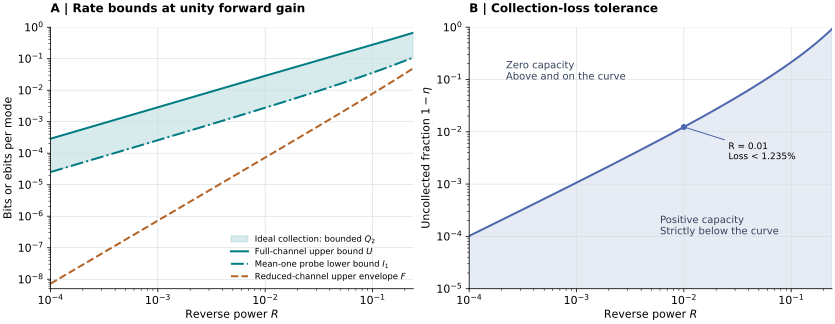

# Atomtronic Isolation Quantum Limits

**How much quantum communication survives when an atomic circuit suppresses
reverse transmission? The answer depends on who can collect the reflected
field.**

This repository derives an exact boundary between impossible and possible
entanglement distribution for a linear directional matter-wave channel. The
boundary applies to arbitrary input states, quantum memories, non-Gaussian
operations and adaptive protocols. A stable pumped atomic model also gives
a matched linear-order two-way quantum communication rate near perfect
reverse isolation when the sender can collect the entire reflection.

## Main results

The canonical model has two positive-signature ports and arbitrary idlers,

```math
\boldsymbol b=A\boldsymbol a+B\boldsymbol e^\dagger,
\qquad AA^\dagger-BB^\dagger=I_2.
```

The sender controls $`a_1`$, the receiver obtains $`b_2`$, and the sender
may collect $`b_1`$ through loss of transmissivity $`\eta`$. All other
inputs are vacuum and the remaining outputs are inaccessible. Define forward
power $`G=|A_{21}|^2`$, reverse power $`R=|A_{12}|^2`$, receiver
spontaneous occupation $`N=(BB^\dagger)_{22}`$, and $`c=N-G`$.

| Result | Statement | Authoritative account |
|---|---|---|
| Exact collection boundary | $`Q_2=K=0`$ precisely when $`c\ge0`$ and $`(1-\eta)c\ge\eta R`$ | [Theorem and proof](science/collection_boundary.md) |
| Reflection discarded | $`N\ge G-R`$; $`R\le1/2`$ forces $`Q=0`$; at fixed $`G>0`$, $`Q_2\le K\le R^2/(2G\ln2)+O(R^3)`$ | [Noise constraints](science/scattering_noise.md) and [rate bound](science/communication_rates.md#1-the-reduced-forward-channel) |
| Ideal reflection collection | An explicit $`G=1`$ family has $`I_1(R)\le Q_2\le U(R)`$, with $`I_1(R)=R/4+O(R^{3/2})`$ and $`U(R)=2R/\ln2+O(R^2)`$ | [Matched linear rate order](science/communication_rates.md#3-a-matching-linear-order-upper-bound-on-the-full-channel) |
| Stable atomic construction | Two driven collision links and one conversion link realize the effective channel with decay margin at least $`0.21995\kappa`$ | [Hamiltonian and resources](science/stable_atomic_model.md) |
| Thermal noise and finite pulses | An exact covariance-matrix boundary handles gauge-invariant noise; pulse projection retains unused positive temporal modes | [Thermal theorem](science/collection_boundary.md#6-gauge-invariant-gaussian-noise) and [finite bandwidth](science/finite_bandwidth.md) |

$`Q`$ is unassisted quantum capacity, $`Q_2`$ is two-way-assisted quantum
capacity, and $`K`$ is secret-key capacity against a purifying environment.
All rates are per independent normalized mode. The ideal-collection bounds
establish $`\Theta(R)`$ scaling with different constants, not an exact
capacity. Its logarithmic-negativity upper bound applies to $`Q_2`$, not
generally to $`K`$.



The shaded band bounds the ideal-collection quantum capacity of the stable
unity-gain family. The dashed curve is a general upper envelope for a
discarded-return channel with the same forward and reverse powers; the
specific family's discarded-return capacity is zero in the plotted range.
The second panel shows the strict collection-loss tolerance for that family.
[Figure definitions and reproduction](verification/README.md#figure).

### One concrete operating point

At $`G=1`$ and $`R=0.01`$, the stable family's reduced forward channel is
entanglement breaking. Ideal collection instead permits at least
**0.002773 ebits per use**, using a two-mode squeezed probe with mean signal
occupation one and a centered receiver state of mean occupation one. Its
full two-way quantum capacity is at most **0.028625 ebits per use**.
Positive capacity requires collection strictly above **98.7654%** for this
example. These numbers describe the effective model, not a measured device.

## Read the science

Start with [Model and main results](science/model.md), which fixes the
operational interface and maps the connected scientific account.

1. [Collection boundary](science/collection_boundary.md): exact theorem,
   infinite-dimensional local-instrument converse, finite-energy positivity,
   thermal extension and corner cases.
2. [Communication rates](science/communication_rates.md): discarded-return
   capacity bounds, bounded-energy recovery, full-channel logarithmic
   negativity and the matched linear rate order.
3. [Scattering and noise](science/scattering_noise.md): canonical inequalities,
   sharp constructions, noise allocation and the additional-port correction.
4. [Stable atomic model](science/stable_atomic_model.md): couplings, stability,
   number-conserving ring collisions, phase references and integrated flux.
5. [Finite bandwidth](science/finite_bandwidth.md): complete pulse-mode
   accounting, a finite-packet entanglement witness and rate-per-time limits.
6. [Physical interpretation](science/interpretation.md): what an isolation
   measurement certifies and how to account for changed resources.

[Related work](references/RELATED_WORK.md) distinguishes the contribution
from established environmental-feedback, Gaussian-channel and amplifier
results. The [bibliography](references/references.bib) records primary
sources. [llms.txt](llms.txt) maps questions to their authoritative pages.

## Learn the project

The single educational anchor is **Weedbrook et al., _Gaussian Quantum
Information_ (2012)**. Start with the [learning overview](learning/README.md)
and [source-to-project bridge](learning/WEEDBROOK_BRIDGE.md), which gives
precise source sections, translates quadrature conventions, and develops
a complete collection-threshold example. It identifies the proof and
atomic-physics ingredients supplied by the project rather than the review.

The [30-milestone map](learning/MILESTONES.md) has **13 background and
17 narrative milestones**. Each has a distinct central question,
understanding target, earlier dependencies, story role, conceptual
connection and source pointers. Both phases proceed from local ingredients
to the complete operational picture. The map is shared learning material,
independent of any reader's assessment history.

## Reproduce the checks

Use Python 3.12 and the recorded numerical dependencies:

```bash
python -m pip install -r verification/requirements.txt
python verification/run_all.py --output verification/results.json
```

The suite checks complex canonical matrices, the full Gaussian partial-
transpose criterion, thermal feedback, finite-energy conditional states,
the Choi polynomial with exact rational arithmetic, Hamiltonian stability,
atomic resonance selection and finite-packet accounting. See
[Verification](verification/README.md) for expected outputs, commands and
the distinction between finite checks and analytical proofs.

[Documentation verification](verification/DOCUMENTATION.md) covers internal
links, the milestone dependency map and the separate inspection of actual
GitHub-rendered mathematics. The verification workflow records the exact
source revision with fresh results and hosted-page captures.

## Scope that changes the result

The exact vacuum scattering boundary assumes **exactly two positive ports**
and complete accounting of the idler sector. An extra positive bath, access
to an idler at the receiver, or a receiver-controlled second input changes
the channel. Collection loss occurs before usable source processing.
Arbitrary phase-sensitive input encodings are covered by the converse;
a phase-sensitive device is a different model.

The atomic realization is a controlled effective model requiring pump,
phase-reference, resonance-selection and continuum assumptions. It is not
an experimental demonstration. Its ideal per-mode asymptotics do not imply
the same scaling per second at fixed bandwidth or with fixed microscopic
errors. The [physical account](science/interpretation.md) and
[bandwidth analysis](science/finite_bandwidth.md) give these limits.

## Purpose and contact

This repository serves as a record of the work and a guide for the author’s self-directed learning. For discussion or potential collaboration, please contact Ruge Lin at [gogoko699@gmail.com](mailto:gogoko699@gmail.com).
